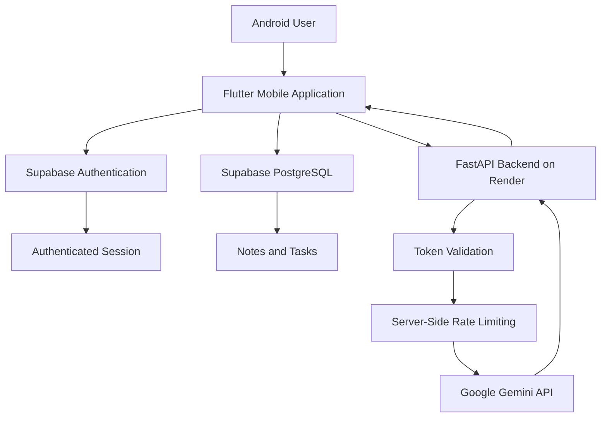

<div align="center">

# 🤖 Personal AI Agent

### An AI-Powered Productivity Assistant for Android

**Chat with Gemini AI. Organize notes. Manage tasks. Sync securely across sessions.**

[](https://flutter.dev)
[](https://fastapi.tiangolo.com)
[](https://supabase.com)
[](https://ai.google.dev)

[](https://github.com/Ashiwany25/Personal-AI-Agent/releases)
[](https://www.android.com)
[](https://github.com/Ashiwany25/Personal-AI-Agent/actions)

**[📥 Download Android App](https://github.com/Ashiwany25/Personal-AI-Agent/releases/tag/v1.0.0)** ·
**[📖 Documentation](#-getting-started)** ·
**[🏗️ Architecture](#%EF%B8%8F-system-architecture)** ·
**[🐛 Report a Bug](https://github.com/Ashiwany25/Personal-AI-Agent/issues)**

</div>

---

## 📌 Overview

**Personal AI Agent** is a full-stack Android productivity application that integrates Google Gemini AI with personal note-taking and task management.

The project demonstrates how to build, secure, deploy, test, and distribute a cloud-connected AI application using modern mobile and backend technologies.

Rather than exposing AI credentials inside the Android application, requests are routed through a FastAPI backend that handles authentication, usage limits, and Gemini API communication.

### The Problem

People often switch between separate applications for:

- Asking AI-powered questions
- Maintaining personal notes
- Tracking everyday tasks
- Accessing their information across sessions

This creates a fragmented productivity experience.

### The Solution

Personal AI Agent brings these functions together in one Android application with secure authentication, cloud storage, and an AI-powered conversational interface.

---

## 📱 Download the App

### 🚀 Version 1.0.0 — Android Release

**[⬇️ DOWNLOAD PERSONAL AI AGENT APK](https://github.com/Ashiwany25/Personal-AI-Agent/releases/tag/v1.0.0)**

| Detail | Information |
|---|---|
| Platform | Android |
| Current documented version | v1.0.0 |
| Distribution | GitHub Releases |
| Account | Required |
| Internet | Required for cloud functionality |
| Backend | FastAPI on Render |
| Database | Supabase PostgreSQL |

### Installation

1. Open the download link.
2. Expand **Assets**.
3. Download the `.apk` file.
4. Open the APK on your Android device.
5. Allow installation from the chosen browser or file manager if prompted.
6. Install and launch Personal AI Agent.
7. Register or sign in.

> **Security note:** Download the APK only from the official GitHub Releases page. Android may warn about applications installed outside Google Play.

---

## ✨ Features

### 🧠 1. Gemini AI Chat

A conversational interface powered by Google Gemini.

- Ask questions using natural language
- Receive AI-generated responses
- Communicate through a dedicated backend
- Authenticate requests using Supabase
- Apply server-side AI usage limits
- Handle API quota restrictions

**Technical flow:**

`Flutter → FastAPI → Authentication → Rate Limiter → Gemini API → Flutter`

### 🔐 2. User Authentication

Account-based authentication powered by Supabase Auth.

- Email/password signup and login
- Authenticated application sessions
- Account-specific access to cloud data
- Supabase access tokens for protected API requests

### 📝 3. Cloud-Synchronized Notes

Manage personal notes through the Android application.

- Create notes
- Save notes to Supabase
- Retrieve saved notes
- Preserve notes across application restarts
- Restrict access to the authenticated account

### ✅ 4. Task Management

Organize personal tasks in one place.

- Create tasks
- View existing tasks
- Mark tasks as completed
- Save task state in the cloud
- Retrieve task data after restarting the application

### ☁️ 5. Persistent Cloud Storage

Supabase PostgreSQL stores application data.

- Persistent notes and tasks
- User-associated records
- Account-level database access policies
- Data synchronization across application sessions

### 🛡️ 6. Backend Security and Rate Limiting

The FastAPI backend provides a controlled interface to Gemini.

- Validates authenticated requests
- Keeps the Gemini API key on the server
- Checks AI request quotas
- Rejects requests exceeding configured limits
- Uses environment variables for private credentials

---

## 🏗️ System Architecture



### Architecture Decisions

| Decision | Reason |
|---|---|
| Flutter | Cross-platform development framework with native Android deployment |
| FastAPI | Lightweight Python framework for AI API integration |
| Supabase Auth | Managed authentication and access-token support |
| PostgreSQL | Persistent relational storage |
| Row Level Security | Database-enforced user data isolation |
| Gemini API | Generative AI response capability |
| Render | Cloud hosting for the Python backend |
| GitHub Actions | Repeatable automated APK builds |
| Release signing | Android application authenticity and update continuity |

### AI Request Lifecycle

1. The user signs in through Supabase.
2. Flutter obtains an authenticated session.
3. The user sends a message through AI Chat.
4. Flutter sends the request to the FastAPI backend.
5. The backend validates the access token.
6. The backend checks the configured request quota.
7. An allowed request is forwarded to Gemini.
8. The generated response is returned to the application.

This separation keeps the private Gemini API key out of the distributed Android APK.

---

## 🛠️ Technology Stack

| Component | Technology |
|---|---|
| Mobile framework | Flutter |
| Mobile language | Dart |
| Backend language | Python |
| API framework | FastAPI |
| Generative AI | Google Gemini |
| Authentication | Supabase Auth |
| Database | PostgreSQL |
| Database access control | Supabase Row Level Security |
| Backend deployment | Render |
| CI/CD | GitHub Actions |
| Release signing | Java Keytool / Android Gradle |
| Source control | Git and GitHub |

---

## 📂 Repository Structure

```text
Personal-AI-Agent/
│
├── .github/
│   └── workflows/
│       ├── android-apk.yml
│       └── android-release.yml
│
├── api/
│   └── main.py
│
├── flutter_app/
│   ├── lib/
│   │   └── main.dart
│   ├── test/
│   ├── pubspec.yaml
│   └── README.md
│
├── .gitignore
└── README.md
```

The diagram highlights the principal application files.

**Build note:** Android platform files are generated during GitHub Actions builds rather than maintained as a committed Android project directory.

---

## 🔌 Backend API

The backend is implemented with FastAPI and hosted on Render.

**Backend:**

https://ashiwany-personal-ai-api.onrender.com

**Interactive API documentation:**

https://ashiwany-personal-ai-api.onrender.com/docs

**Health endpoint:**

https://ashiwany-personal-ai-api.onrender.com/health

### Available Endpoints

| Method | Route | Description |
|---|---|---|
| `GET` | `/health` | Check backend health |
| `POST` | `/chat` | Process authenticated AI chat requests |

The root URL (`/`) is not intended as a website homepage. A `404 Not Found` response at that path does not necessarily indicate a backend failure.

### API Rate Limiting

The backend enforces AI request quotas using server-side logic and database-backed usage records.

Requests exceeding a configured limit can receive:

`HTTP 429 Too Many Requests`

This protects the AI service from excessive usage and helps manage provider quotas.

---

## 🗄️ Database and Authentication

Supabase provides authentication and PostgreSQL storage.

### Database Tables

| Table | Responsibility |
|---|---|
| `notes` | Personal note records |
| `tasks` | Task records and completion state |
| `conversations` | Conversation-related records |
| `ai_rate_limits` | AI request quota tracking |

### Data Isolation

Row Level Security policies are used to restrict access to user-owned records.

The intended security model ensures that:

- A user accesses their own notes.
- A user accesses their own tasks.
- Cloud records are associated with an authenticated account.
- Access to another user's private data is denied.

This behavior was tested using two separate accounts.

---

## 🚀 Getting Started

### Prerequisites

Install:

- Git
- Python
- Flutter SDK
- Android SDK
- Android device or emulator

### 1. Clone the Repository

```bash
git clone https://github.com/Ashiwany25/Personal-AI-Agent.git

cd Personal-AI-Agent
```

### 2. Configure the Python Environment

```bash
python3 -m venv .venv

source .venv/bin/activate
```

Install the project's Python dependencies using the requirements file supplied in the repository.

For example, if the backend requirements file is located in `api/`:

```bash
pip install -r api/requirements.txt
```

### 3. Configure Backend Environment Variables

The backend expects the following configuration:

```dotenv
SUPABASE_URL=your_supabase_project_url
SUPABASE_PUBLISHABLE_KEY=your_supabase_publishable_key
SUPABASE_SECRET_KEY=your_server_side_secret
GEMINI_API_KEY=your_gemini_api_key
GEMINI_MODEL=your_supported_gemini_model
```

Use your own Supabase and Gemini credentials.

**Never commit real secret values to the repository.**

### 4. Run the Backend

From the repository root:

```bash
uvicorn api.main:app --reload
```

The development server normally runs at:

`http://127.0.0.1:8000`

API documentation:

`http://127.0.0.1:8000/docs`

### 5. Configure Flutter

```bash
cd flutter_app

flutter pub get

flutter doctor
```

If Android platform files are missing:

```bash
flutter create \
  --platforms android \
  --project-name personal_ai_agent \
  --org com.ashiwany \
  .
```

Ensure the Flutter application is configured with the appropriate Supabase project and reachable backend URL.

### 6. Run the Android Application

```bash
flutter run
```

Connect an Android device or start an emulator before running the command.

---

## 🔄 CI/CD and Android Releases

The repository contains separate GitHub Actions workflows for debug and signed release builds.

### Debug Workflow

File:

`.github/workflows/android-apk.yml`

Responsibilities:

- Install Flutter
- Generate Android platform files
- Install packages
- Run Flutter analysis
- Run automated tests
- Build a debug APK
- Upload the build artifact

### Release Workflow

File:

`.github/workflows/android-release.yml`

Responsibilities:

- Generate the Android project
- Add Android internet permission
- Validate the Flutter project
- Restore the signing keystore from encrypted secrets
- Configure Gradle release signing
- Build a release APK
- Upload the APK as a workflow artifact

### Release Signing

Android release signing uses these GitHub Actions secrets:

- `ANDROID_KEYSTORE_BASE64`
- `ANDROID_KEYSTORE_PASSWORD`
- `ANDROID_KEY_PASSWORD`
- `ANDROID_KEY_ALIAS`

The signing key and passwords are not intended to be stored in public source files.

**Android application ID:**

`com.ashiwany.personal_ai_agent`

Maintaining the same application ID and signing key is important for future Android updates.

### Public Distribution

The tested APK is distributed through GitHub Releases.

**[View Releases](https://github.com/Ashiwany25/Personal-AI-Agent/releases)**

---

## 🧪 Testing and Validation

The application was tested during development and release preparation.

### Verified Functional Tests

| Test Case | Result |
|---|---|
| Android debug APK build | Passed |
| Signed release APK build | Passed |
| Release APK installation | Passed |
| User login | Passed |
| Gemini AI response | Passed |
| Note creation and persistence | Passed |
| Task creation and completion | Passed |
| Cloud synchronization | Passed |
| Persistence after application restart | Passed |
| Two-account data isolation | Passed |
| AI rate-limit rejection | Passed |
| Public APK download | Passed |

### Real-Device Testing

The release APK was installed and tested on a Samsung Android smartphone.

The initial release build revealed a network connectivity issue caused by missing Android internet permission.

The release workflow was updated to include the permission, the APK was rebuilt, and authentication and cloud-connected features were successfully retested.

This illustrates an important development practice:

**Build → Test → Identify Failure → Fix → Rebuild → Verify**

### Testing Limitations

Successful functional tests do not establish:

- Compatibility with every Android device
- Complete automated test coverage
- Security against every attack
- Guaranteed AI service uptime
- Production scalability under heavy traffic

Additional testing is recommended before large-scale distribution.

---

## 🔒 Security Design

Security was considered at the application, backend, database, and build levels.

### Application Security

- Supabase authentication
- Authenticated access to user data
- No intended embedding of private Gemini credentials in the APK

### Backend Security

- Authentication token validation
- Server-side AI requests
- AI usage quotas
- Environment-based secret configuration

### Database Security

- PostgreSQL Row Level Security
- User-associated records
- Separate permissions for client and privileged server operations

### Build Security

- Signing credentials stored in GitHub Actions secrets
- Private keystore excluded from source control
- Separate release-signing workflow

### Responsible Use

Do not upload private keys, credentials, passwords, or sensitive personal information to public GitHub issues.

AI-generated responses can be inaccurate and should be independently verified for consequential decisions.

---

## ⚠️ Known Limitations

| Limitation | Explanation |
|---|---|
| Internet dependency | Cloud-connected features require network access |
| AI quota restrictions | Gemini usage depends on provider limits |
| Free-tier hosting | Backend startup delays and resource restrictions may occur |
| Android distribution | APK is distributed outside Google Play |
| Device coverage | Testing has not covered every Android version or manufacturer |
| AI reliability | Model responses are not guaranteed to be correct |

---

## 🗺️ Roadmap

The following are possible future enhancements, not features claimed to exist in v1.0.0.

- [ ] Voice interaction
- [ ] AI-assisted task creation
- [ ] Smart reminders and notifications
- [ ] Search across personal notes
- [ ] Offline note and task support
- [ ] Enhanced conversation history
- [ ] Improved automated integration tests
- [ ] Automated release versioning
- [ ] Expanded Android device testing
- [ ] Google Play Store publication

---

## 💡 Engineering Challenges and Lessons

### 1. Securing AI Credentials

**Challenge:** Mobile applications can be inspected, making embedded API secrets unsafe.

**Approach:** Use a backend to communicate with Gemini and keep private credentials on the server.

### 2. Protecting Multi-User Data

**Challenge:** A cloud database must prevent one account from accessing another account's private information.

**Approach:** Combine authenticated user sessions with PostgreSQL Row Level Security.

### 3. Controlling AI API Usage

**Challenge:** AI services have request quotas and resource limitations.

**Approach:** Enforce rate limits on the backend instead of trusting client-side controls.

### 4. Building Android Releases in the Cloud

**Challenge:** Producing distributable Android APKs requires build tooling and signing configuration.

**Approach:** Automate Flutter builds and release signing through GitHub Actions.

### 5. Debugging Release-Only Issues

**Challenge:** A working debug application does not guarantee a working release build.

**Approach:** Test the signed APK on a physical device, identify configuration differences, and validate fixes.

---

## 🎯 Project Outcomes

This project demonstrates experience with:

- Full-stack application development
- Flutter mobile development
- Python REST API development
- Generative AI integration
- Authentication and authorization
- PostgreSQL database design
- Cloud deployment
- Server-side rate limiting
- CI/CD automation
- Android signing and distribution
- Real-device debugging
- Multi-user functional testing
  

## 🤝 Contributing

Suggestions, bug reports, and improvement ideas are welcome.

To propose an improvement:

1. Open an issue describing the problem or feature.
2. Discuss the proposed change before major modifications.
3. Fork the repository.
4. Create a dedicated feature branch.
5. Submit a pull request explaining the changes and testing performed.

For security-sensitive issues, avoid publishing credentials or exploitable private details in public issues.

---

## 🐛 Issues and Feedback

Found a bug or have a suggestion?

**[Open a GitHub Issue](https://github.com/Ashiwany25/Personal-AI-Agent/issues)**

When reporting a bug, include:

- Android version
- Application version
- Steps to reproduce
- Expected behavior
- Actual behavior
- Relevant error message without sensitive information

---

## 📦 Release History

| Version | Description |
|---|---|
| v1.0.0 | Initial Android release with AI Chat, authentication, Notes, Tasks, and cloud synchronization |

**[Download the Latest Available Release](https://github.com/Ashiwany25/Personal-AI-Agent/releases)**

---

<div align="center">
    
## 👨‍💻 Developer

**Ashiwany Kumar**

Computer Science and Engineering (AI & ML)  
Haldia Institute of Technology

[](https://github.com/Ashiwany25)

---

<div align="center">

### ⭐ Support the Project

If you find this project useful, consider starring the repository.

**Built with Flutter, FastAPI, Supabase, and Google Gemini.**

[⬆ Back to Top](#-personal-ai-agent)

</div>
